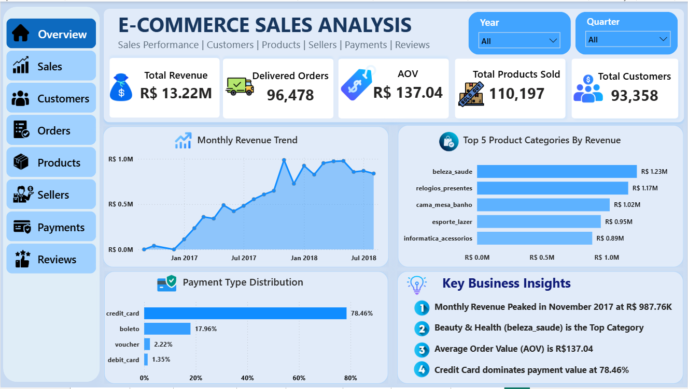
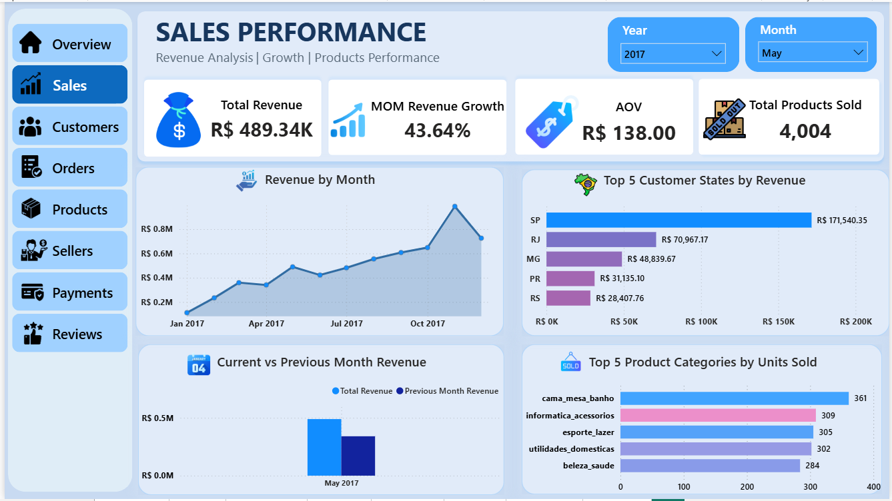
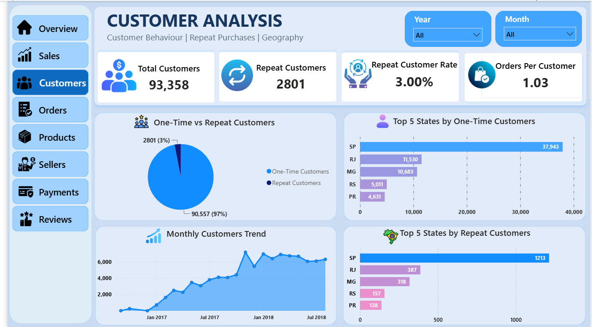
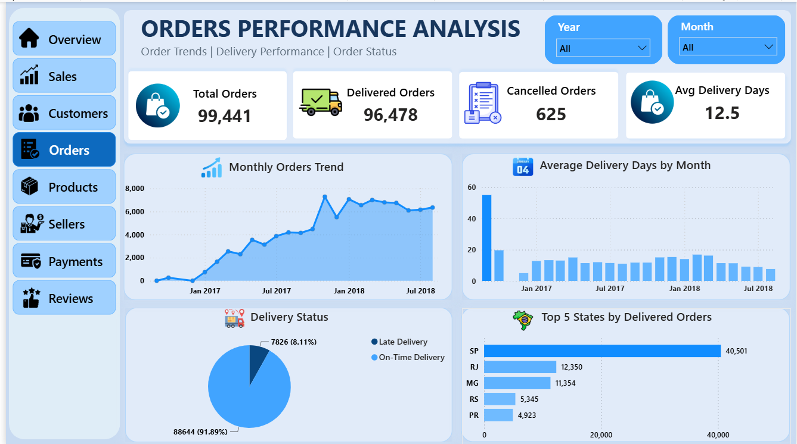
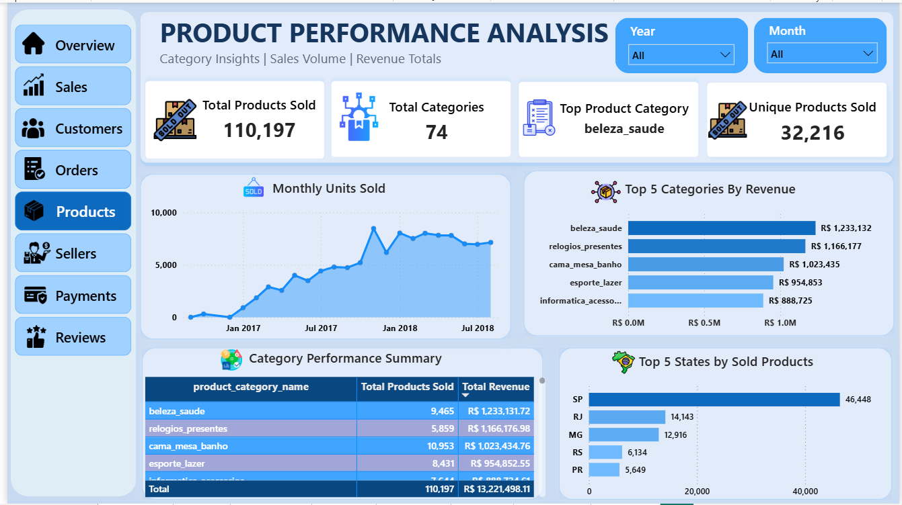
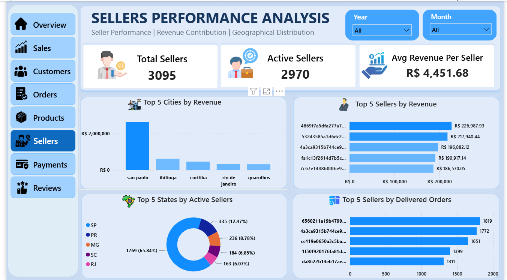
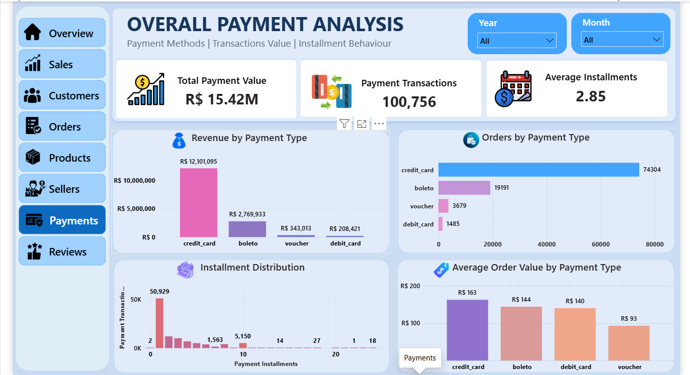
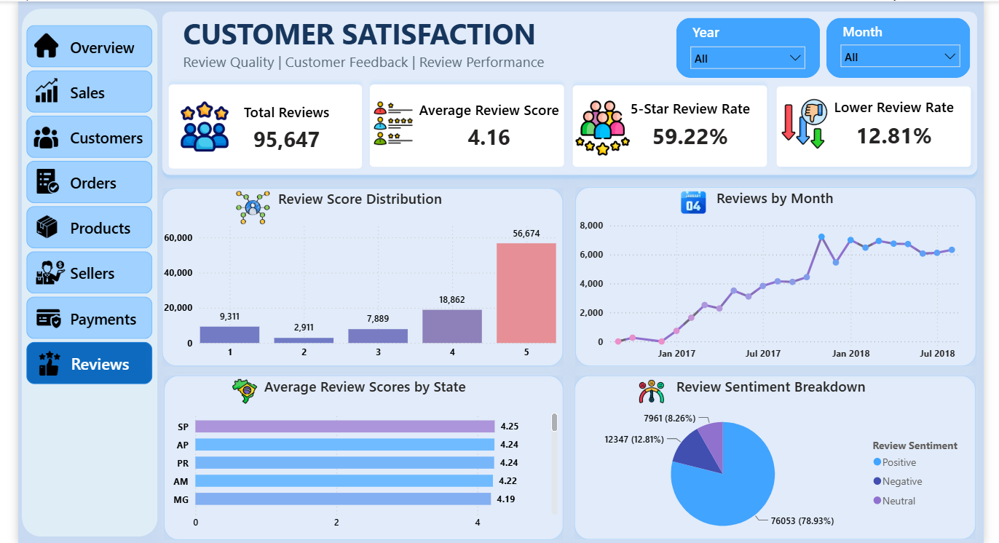

# 📊 E-Commerce Sales Analysis

An end-to-end data analytics project exploring e-commerce sales, customer behaviour, order performance, product trends, seller performance, payment patterns, and customer reviews using **MySQL and Power BI**.

## 📌 Project Overview

This project analyzes the Brazilian E-Commerce Public Dataset by Olist to identify business trends, evaluate sales performance, and generate meaningful insights.

The project involves data cleaning, data validation, SQL-based business analysis, and interactive Power BI dashboard development.

## 🎯 Business Objectives

- Analyze overall sales and revenue performance.
- Understand customer purchasing behaviour and repeat purchases.
- Evaluate order status and delivery performance.
- Identify top-performing products and categories.
- Analyze seller performance and geographical distribution.
- Understand payment methods and installment behaviour.
- Evaluate customer satisfaction through reviews.

## 🛠️ Tools & Technologies

| Tool | Purpose |
|---|---|
| MySQL | Data cleaning, validation and analysis |
| Power BI | Dashboard development and visualization |
| DAX | Measures and business calculations |
| Power Query | Data transformation |
| GitHub | Project documentation and version control |

## 📂 Project Structure

```text
E-Commerce-Sales-Analysis/
│
├── README.md
│
├── sql/
│   └── ECommerce_Sales_Analysis.sql
│
├── powerbi/
│   ├── E-Commerce Sales Analysis Dashboard.pbix
│   └── E-Commerce Sales Analysis Dashboard.pdf
│
├── screenshots/
│   ├── overview.png
│   ├── SalesPerformance.png
│   ├── CustomerAnalysis.png
│   ├── OrdersPerformanceAnalysis.png
│   ├── ProductPerformanceAnalysis.png
│   ├── SellersPerformanceAnalysis.png
│   ├── OverallPaymentAnalysis.png
│   └── Reviews.png
│
└── docs/
```

## 📈 Dashboard Overview

The Power BI dashboard contains eight analytical pages.

### 1. Overall Dashboard



### 2. Sales Performance Analysis



### 3. Customer Analysis



### 4. Orders Performance Analysis



### 5. Product Performance Analysis



### 6. Sellers Performance Analysis



### 7. Payment Analysis



### 8. Customer Satisfaction & Reviews



## 📊 Key Performance Indicators (KPIs)

The project includes the following business metrics:

- Total Revenue
- Delivered Orders
- Average Order Value (AOV)
- Total Products Sold
- Total Customers
- Repeat Customers
- Average Delivery Days
- Total Product Categories
- Active Sellers
- Average Revenue per Seller
- Total Payment Value
- Average Installments
- Average Review Score
- 5-Star Review Rate

## 🔍 SQL Analysis

MySQL was used for:

- Database preparation and table relationships.
- Data cleaning and validation.
- Handling missing and inconsistent values.
- Duplicate and data quality checks.
- Joins, aggregations, subqueries, CTEs and window functions.
- Business KPI calculations and analysis.

## 💡 Key Business Insights

The dashboard highlights several business observations:

- Monthly revenue peaked in November 2017 at approximately R$ 987.76K.
- The `beleza_saude` category generated the highest revenue.
- Credit cards accounted for approximately 78.46% of payment value.
- The overall average order value was approximately R$ 137.04.
- The average customer review score was 4.16.

## 📁 Dataset

**Source:** Brazilian E-Commerce Public Dataset by Olist.

[Kaggle Dataset](https://www.kaggle.com/datasets/olistbr/brazilian-ecommerce)

The dataset contains information about customers, orders, products, sellers, payments, geolocation and reviews.

## 🚀 How to Explore This Project

1. Review the SQL scripts in the `sql` folder.
2. Open the dashboard PDF in the `powerbi` folder for a quick preview.
3. Open the PBIX file using Power BI Desktop to explore the interactive dashboard.
4. Explore the screenshots to understand the individual dashboard pages.

## 👨‍💻 Author

**Gaurav Paul**

Aspiring Data Analyst | SQL | Power BI | Python

GitHub: [paulgaurav9876-cpu](https://github.com/paulgaurav9876-cpu)

---

⭐ If you find this project interesting, feel free to explore the repository!